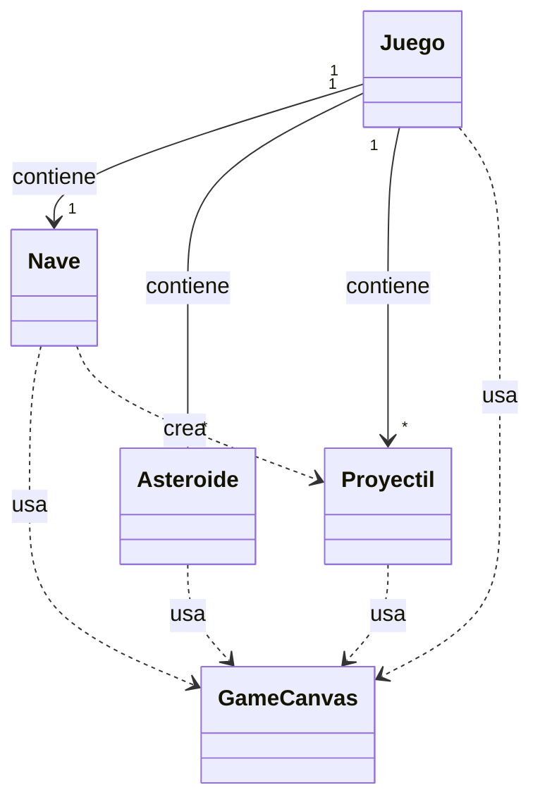

# Sesión 11 — Diagrama de Clases UML y Relaciones

## 0. Errores encontrados en el diagrama de ejemplo
1. **Asociación que debería ser dependencia:** `Asteroide --> GameCanvas : usa` tiene flecha continua (asociación/campo), pero debe ser punteada (`..>`) porque `Asteroide` no guarda el lienzo como atributo, solo lo recibe temporalmente como parámetro en el método de dibujo.
2. **Multiplicidad imposible:** `Mundo "*" --> "1" Asteroide : contiene` dice que muchos mundos contienen un solo asteroide. Está al revés: debe ser `"1" --> "*"` (un mundo contiene muchos asteroides).
3. **Relación que falta:** Falta la dependencia `Nave ..> Disparo : crea`, ya que según el enunciado la nave es la responsable de disparar (instanciar) los proyectiles.

---

## 1. El diagrama en Mermaid

---

## 2. Tabla de relaciones

| Desde | Hacia | Tipo | Por qué (¿es un campo o un parámetro?) |
| :--- | :--- | :--- | :--- |
| Juego | Nave | Asociación | Es un **campo**: el juego guarda la instancia de la nave durante toda la partida (`private Nave nave;`). |
| Juego | Asteroide | Asociación | Es un **campo**: el juego guarda una lista de asteroides activos (`private List<Asteroide> asteroides;`). |
| Juego | Proyectil | Asociación | Es un **campo**: el juego guarda una lista de proyectiles activos (`private List<Proyectil> proyectiles;`). |
| Juego | GameCanvas | Dependencia | Es un **parámetro**: lo recibe temporalmente en `draw(GameCanvas canvas)` sin guardarlo. |
| Nave | GameCanvas | Dependencia | Es un **parámetro**: lo recibe temporalmente en `dibujar(GameCanvas canvas)` para pintarse. |
| Asteroide | GameCanvas | Dependencia | Es un **parámetro**: lo recibe temporalmente en `dibujar(GameCanvas canvas)` para pintarse. |
| Proyectil | GameCanvas | Dependencia | Es un **parámetro**: lo recibe temporalmente en `dibujar(GameCanvas canvas)` para pintarse. |
| Nave | Proyectil | Dependencia | Es un **retorno / variable local**: la nave crea y devuelve el objeto `Proyectil` al disparar, pero no almacena la colección de proyectiles. |

---

## 3. Alternativa en texto

Cinco cajas: Juego, Nave, Asteroide, Proyectil y GameCanvas.

Del Juego salen tres asociaciones de línea continua, las tres etiquetadas «contiene». La primera va hacia Nave, con multiplicidad «uno» en el extremo del Juego y «uno» en el de la Nave. La segunda va hacia Asteroide, con «uno» en el Juego y «muchos» en el Asteroide. La tercera va hacia Proyectil, con «uno» en el Juego y «muchos» en el Proyectil.

Del Juego, de la Nave, del Asteroide y del Proyectil salen sendas dependencias de línea discontinua hacia GameCanvas, las cuatro etiquetadas «usa» y sin multiplicidad en ninguno de los extremos. Además, de la Nave sale una dependencia de línea discontinua hacia Proyectil, etiquetada «crea» y también sin multiplicidad. GameCanvas no tiene flechas salientes hacia ninguna caja.

---

## 4. El reto: Añadir un enemigo que dispara

* **Cajas nuevas:** `Enemigo`
* **Líneas que cambian / se añaden:**
  * `Juego "1" --> "*" Enemigo : contiene` (Asociación)
  * `Enemigo ..> GameCanvas : usa` (Dependencia)
  * `Enemigo ..> Proyectil : crea` (Dependencia)
* **¿Está tu modelo bien repartido o rígido?:** Está bien repartido. Añadir un enemigo nuevo no obliga a modificar las clases `Nave`, `Proyectil` ni `Asteroide`; el `Enemigo` simplemente reutiliza la clase `Proyectil` existente para disparar y `Juego` agrega una lista para gestionarlo.