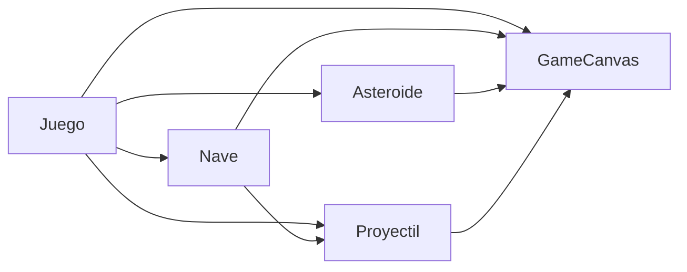

# Modelo de Dominio - Space Shooter

## Tarjetas CRC

┌─────────────────────────────────────────────┐
│ Clase: Nave                                 │
├──────────────────────┬──────────────────────┤
│ Responsabilidades    │ Colaboradores        │
│                      │                      │
│ - Conoce su posición, ángulo, vidas y       │ - Proyectil          │
│   estado de invulnerabilidad temporal.      │ - GameCanvas         │
│ - Modifica sus coordenadas espaciales.      │                      │
│ - Altera su ángulo para apuntar.            │                      │
│ - Fabrica un proyectil orientado hacia      │                      │
│   su frente.                                │                      │
└──────────────────────┴──────────────────────┘

┌─────────────────────────────────────────────┐
│ Clase: Asteroide                            │
├──────────────────────┬──────────────────────┤
│ Responsabilidades    │ Colaboradores        │
│                      │                      │
│ - Conoce su posición, trayectoria y tamaño. │ - GameCanvas         │
│ - Avanza en línea recta constantemente.     │                      │
│ - Rota sobre su propio centro.              │                      │
│ - Produce dos asteroides menores al         │                      │
│   recibir impacto.                          │                      │
└──────────────────────┴──────────────────────┘

┌─────────────────────────────────────────────┐
│ Clase: Proyectil                            │
├──────────────────────┬──────────────────────┤
│ Responsabilidades    │ Colaboradores        │
│                      │                      │
│ - Conoce sus coordenadas y dirección.       │ - GameCanvas         │
│ - Avanza rectilíneamente por la pantalla.   │                      │
│ - Informa si ha superado los límites de     │                      │
│   la pantalla.                              │                      │
└──────────────────────┴──────────────────────┘

┌─────────────────────────────────────────────┐
│ Clase: Juego                                │
├──────────────────────┬──────────────────────┤
│ Responsabilidades    │ Colaboradores        │
│                      │                      │
│ - Conoce la puntuación actual.              │ - Nave               │
│ - Mantiene las listas de elementos móviles. │ - Asteroide          │
│ - Detecta las colisiones entre elementos.   │ - Proyectil          │
│ - Finaliza la partida al agotarse las vidas.│ - GameCanvas         │
└──────────────────────┴──────────────────────┘

## Mapa de Colaboraciones

**Alternativa en texto:**
Cuatro cajas del dominio (Juego, Nave, Asteroide y Proyectil) más el lienzo (GameCanvas)[cite: 11, 15]. El Juego le pide acciones a la Nave, al Asteroide, al Proyectil y a GameCanvas. La Nave le pide algo al Proyectil (porque lo fabrica al disparar) y a GameCanvas (para dibujarse)[cite: 7]. Tanto el Asteroide como el Proyectil le piden algo únicamente a GameCanvas para dibujarse en pantalla. GameCanvas no le pide nada a nadie.

## Intercambio de Modelos y Evolución

**Preguntas que mi compañero no pudo responder sobre mi modelo:**
*(Espacio reservado para anotar las dudas durante la actividad de intercambio en clase)*[cite: 7]

**Modificaciones realizadas tras la Sesión 11:**
- Se añadió `GameCanvas` como colaborador explícito en las tarjetas de `Nave`, `Asteroide` y `Proyectil` (y en el mapa de colaboraciones) para mantener coherencia exacta con las dependencias de dibujo (`..>`) definidas en el diagrama de clases UML de la Sesión 11[cite: 11, 15].